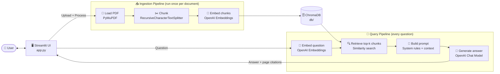
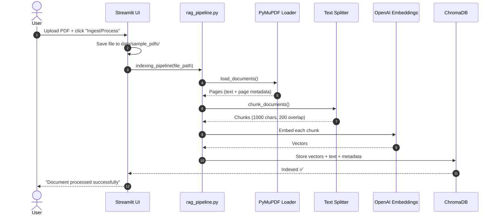
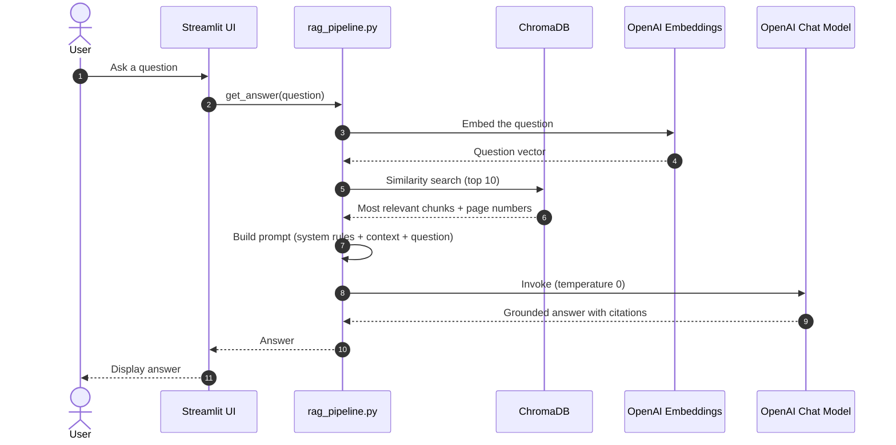
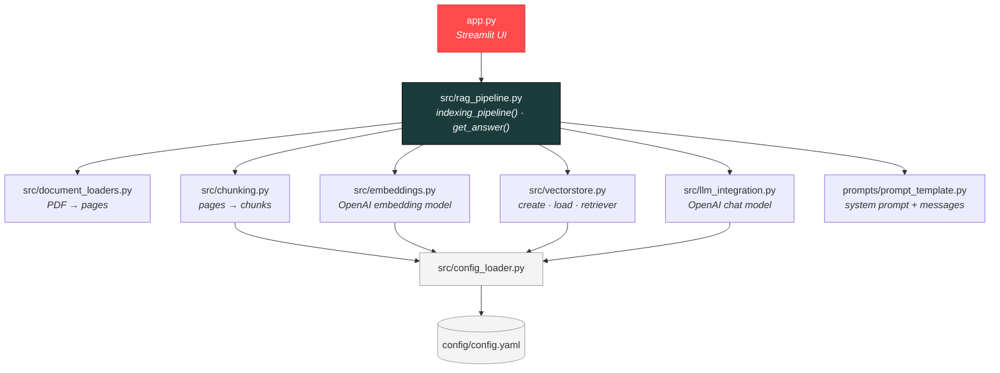
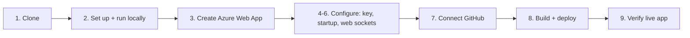
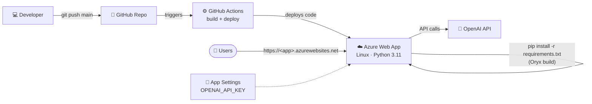

<div align="center">

# 📑 Financial Policy Document Assistant

**A GenAI chatbot that answers financial policy and compliance questions strictly from your documents, with page citations.**


</div>

---

## 📌 Table of Contents

- [Business Problem](#-business-problem)
- [Solution Overview](#-solution-overview)
- [System Architecture](#️-system-architecture)
- [How It Works](#-how-it-works)
- [Module Design](#-module-design)
- [Design Decisions](#-design-decisions)
- [Tech Stack](#-tech-stack)
- [Project Structure](#-project-structure)
- [Step-by-Step Guide: Clone → Run → Deploy](#-step-by-step-guide-clone--run--deploy)
- [Configuration](#️-configuration)
- [Troubleshooting](#-troubleshooting)
- [Limitations & Roadmap](#-limitations--roadmap)

---

## 💼 Business Problem

Banks, insurers and financial institutions work with **thousands of pages** of compliance manuals, regulatory filings and internal policies (Basel III, IFRS, RBI circulars, procurement rules, approval limits).

| Pain point | Impact |
|---|---|
| Manual searching through long PDFs | Slow, error-prone, wastes staff time |
| Misreading a threshold or approval level | Compliance breaches, fines, audit findings |
| Non-technical staff need answers fast | Audits, onboarding and reporting are time-critical |
| Generic chatbots hallucinate | Unacceptable in a regulated domain |

## ✅ Solution Overview

An assistant that **ingests policy PDFs**, indexes them as vector embeddings, and answers questions using **Retrieval-Augmented Generation (RAG)**:

- 🔍 **Grounded answers:** the LLM only sees the most relevant passages from your documents
- 📄 **Citations:** every answer references the source file and page number
- 🚫 **No guessing:** if the document doesn't cover it, the assistant says so
- 💬 **Plain English:** anyone can ask questions; no search skills needed

---

## 🏗️ System Architecture



---

## 🔄 How It Works

### 1. Ingestion: turning a PDF into searchable vectors



### 2. Question answering: retrieve, then generate



### Example

> **Q:** What are the quotation requirements based on purchase value?
>
> **A:** The assistant retrieves the procurement section of the policy and returns the purchase-value thresholds and the number of quotations each one requires, citing the source file and page.

---

## 🧩 Module Design

Each RAG step lives in its own module, so any component (loader, embedding model, vector store, LLM) can be swapped without touching the rest.



| Module | Responsibility | Key function |
|---|---|---|
| `app.py` | Upload, ingest and Q&A interface | Streamlit page |
| `src/rag_pipeline.py` | Orchestrates both pipelines | `indexing_pipeline()`, `get_answer()` |
| `src/document_loaders.py` | Reads PDF pages with metadata | `load_documents()` |
| `src/chunking.py` | Splits pages into overlapping chunks | `chunk_documents()` |
| `src/embeddings.py` | Creates the embedding model | `get_embedding_model()` |
| `src/vectorstore.py` | Creates, loads and queries ChromaDB | `create_vector_store()`, `get_retriever()` |
| `src/llm_integration.py` | Creates the chat model | `get_llm_model()` |
| `prompts/prompt_template.py` | Grounding rules + message builder | `build_prompt()` |
| `src/config_loader.py` | Loads settings once (cached) | `load_config()` |

---

## 🧠 Design Decisions

| Decision | Choice | Why |
|---|---|---|
| **PDF loader** | PyMuPDF | Fast, accurate text extraction, keeps page numbers for citations |
| **Chunking** | Recursive splitter, 1000 chars / 200 overlap | Breaks on paragraph → line → sentence → word, so clauses stay intact; overlap prevents losing context at chunk edges |
| **Embeddings** | OpenAI `text-embedding-ada-002` | Strong semantic search quality, no model hosting needed |
| **Vector store** | ChromaDB (persisted to `db/`) | Lightweight, runs locally, no extra infrastructure for a POC |
| **Retrieval** | Similarity search, top 10 | Policy answers often span several sections; 10 chunks gives enough coverage |
| **LLM** | OpenAI chat model, temperature 0 | Deterministic, factual answers suited to compliance |
| **Grounding** | Strict system prompt | Answer only from context, quote figures exactly, cite pages, say "not covered" instead of guessing |
| **Configuration** | `config/config.yaml` | Change models or retrieval settings without editing code |

---

## 🛠️ Tech Stack

| Layer | Technology |
|---|---|
| Frontend | Streamlit |
| Orchestration | LangChain (`langchain-core`, `langchain-community`, `langchain-text-splitters`, `langchain-openai`) |
| Document loading | PyMuPDF |
| Embeddings | OpenAI Embeddings |
| Vector database | ChromaDB |
| LLM | OpenAI Chat Completions |
| Config / secrets | YAML + `python-dotenv` |
| Hosting | Azure Web App (Linux, Python) via GitHub Actions |

---

## 📁 Project Structure

```
Project_1_Financial_Policy_ChatBot_Rag_Implementation/
├── app.py                      # Streamlit UI: upload, ingest, Q&A
├── src/
│   ├── __init__.py
│   ├── config_loader.py        # Reads config/config.yaml (cached)
│   ├── document_loaders.py     # PDF → pages (PyMuPDF)
│   ├── chunking.py             # Pages → overlapping chunks
│   ├── embeddings.py           # OpenAI embedding model
│   ├── vectorstore.py          # ChromaDB create / load / retriever
│   ├── llm_integration.py      # OpenAI chat model
│   └── rag_pipeline.py         # indexing_pipeline() + get_answer()
├── prompts/
│   └── prompt_template.py      # System prompt + message builder
├── config/
│   └── config.yaml             # Models, chunking and retriever settings
├── data/
│   └── sample_pdfs/            # Uploaded / sample policy PDFs
├── exploration/
│   └── notebook.ipynb          # Step-by-step RAG prototype
├── Project_Preparation/
│   └── README.md               # Business case and planning notes
├── project_templates.py        # Scaffolds the folder structure
├── requirements.txt
├── setup.py
└── .gitignore                  # Excludes .env, venv/, db/
```

---

## 🚀 Step-by-Step Guide: Clone → Run → Deploy

Follow these steps in order. Each step is numbered so you can follow along with the video.



**Prerequisites:** Python 3.11+, Git, VS Code, a GitHub account, an Azure account, an [OpenAI API key](https://platform.openai.com/api-keys).

---

### Part A: Get the code running locally

#### Step 1: Clone the repository

```bash
git clone https://github.com/ajeetuk/Project_1_Financial_Policy_ChatBot_Rag_Implementation.git
cd Project_1_Financial_Policy_ChatBot_Rag_Implementation
code .
```

#### Step 2: Set up and run locally

```bash
# Create and activate a virtual environment
python -m venv venv

# Windows (Command Prompt)
venv\Scripts\activate.bat
# Windows (PowerShell)
.\venv\Scripts\Activate.ps1
# macOS / Linux
source venv/bin/activate

# Install dependencies
python -m pip install -r requirements.txt     # or: uv pip install -r requirements.txt
```

Create a `.env` file in the project root:

```env
OPENAI_API_KEY=sk-your-key-here
```

> 🔒 `.env` is in `.gitignore`, so your key is never pushed to GitHub.

Run the app:

```bash
python -m streamlit run app.py
```

Open http://localhost:8501 → upload `data/sample_pdfs/6_financial-policies-and-procedures_2022.pdf` → click **Ingest/Process Document** → ask a question. Stop with `Ctrl+C`.

---

### Part B: Deploy to Azure Web App (Azure Portal)



> **Before you start:** GitHub Actions must be available on your account (no billing lock, or the repo is public).

#### Step 3: Create the Web App

[portal.azure.com](https://portal.azure.com) → **Create a resource → Web App** → **Basics** tab:

| Field | Value |
|---|---|
| Resource Group | Create new, e.g. `rg-financial-policy-bot` |
| Name | Unique name, e.g. `financial-policy-chatbot` (becomes the URL) |
| Publish | Code |
| Runtime stack | Python 3.11 |
| Operating System | **Linux** |
| Region | Central India (or nearest) |
| Pricing plan | **Basic B1** (Free F1 is too slow for ChromaDB) |

Click **Review + create → Create**, then **Go to resource**.

#### Step 4: Add environment variables

**Settings → Environment variables → App settings → + Add**

| Name | Value |
|---|---|
| `OPENAI_API_KEY` | your OpenAI API key |
| `SCM_DO_BUILD_DURING_DEPLOYMENT` | `true` |

Click **Apply** and confirm the restart.

#### Step 5: Set the startup command

**Settings → Configuration → General settings → Startup Command:**

```bash
python -m streamlit run app.py --server.port 8000 --server.address 0.0.0.0 --server.headless true
```

#### Step 6: Turn on web sockets

On the same **General settings** page, set **Web sockets** to **On** (Streamlit needs it, otherwise the page stays blank). Click **Save → Continue**.

#### Step 7: Connect GitHub (CI/CD)

**Deployment → Deployment Center**

| Field | Value |
|---|---|
| Source | GitHub (click **Authorize** and sign in) |
| Organization | your GitHub account |
| Repository | this repository |
| Branch | `main` |
| Authentication | User-assigned identity (default) |

Click **Save**. Azure adds a workflow under `.github/workflows/` and starts the first deployment. From now on, every push to `main` redeploys automatically.

#### Step 8: Watch the build and deploy

Open the **Actions** tab on GitHub (or **Logs** in Deployment Center). Wait for both **build** and **deploy** jobs to turn green (about 5–10 minutes; `chromadb` is large).

#### Step 9: Verify the live app

1. Azure Portal → **Overview** → click **Default domain** (`https://<app-name>.azurewebsites.net`).
2. Upload the sample PDF → **Ingest/Process Document** → ask:
   - *What are the quotation requirements based on purchase value?*
   - *Who are the current authorised bank signatories?*
   - *What's the capital of France?* (should politely decline: not in the document)
3. Open **Monitoring → Log stream** to see the app running.

> 💡 `db/` isn't stored in Git, so process the document once after each fresh deployment.
>
> 💸 **Basic B1 is a paid plan.** If you're only practising, delete the resource group when you're done.

---

## ⚙️ Configuration

All tunable settings live in [`config/config.yaml`](config/config.yaml):

```yaml
chunking:
  chunk_size: 1000
  chunk_overlap: 200
  separators: ["\n\n", "\n", ".", " ", ""]

embeddings:
  model: text-embedding-ada-002

vector_store:
  persist_directory: db

retriever:
  search_type: similarity
  k: 10

llm:
  model_name: gpt-5.4-mini-2026-03-17
  temperature: 0
```

> ⚠️ If you change the **embedding model** or **chunking settings**, delete the `db/` folder and process the documents again.

---

## 🩺 Troubleshooting

### Local (Windows)

| Problem | Fix |
|---|---|
| `pip.exe` / `streamlit.exe` blocked by Device Guard | Use `python -m pip ...` and `python -m streamlit run app.py` |
| `DLL load failed ... Application Control policy` | Windows Smart App Control is blocking a compiled package. Turn it off, or use WSL / GitHub Codespaces |
| `module 'pymupdf._mupdf' has no attribute ...` | Mixed PyMuPDF install. Close all Python processes, delete `venv\Lib\site-packages\pymupdf`, reinstall `pymupdf==1.28.2` |
| Duplicate answers after re-processing | Delete `db/` and process each PDF once |
| `OPENAI_API_KEY` not found | Check that `.env` exists in the project root |

### Azure

Check **Monitoring → Log stream** first.

| Symptom | Fix |
|---|---|
| "Application Error" / container keeps restarting | Check the startup command (Step 5) |
| Page loads but stays blank or keeps reconnecting | Turn **Web sockets** On (Step 6) |
| `ModuleNotFoundError` | Set `SCM_DO_BUILD_DURING_DEPLOYMENT=true` and redeploy |
| OpenAI authentication error | Check the `OPENAI_API_KEY` app setting |
| GitHub job "not started … billing issue" | Fix billing in GitHub **Settings → Billing**, or make the repo public |

---

## 🧭 Limitations & Roadmap

| Current limitation | Planned improvement |
|---|---|
| Re-processing the same PDF adds duplicate chunks | Hash documents and skip ones already indexed |
| `db/` is lost on redeploy | Azure AI Search or a persistent vector DB |
| PDFs only | DOCX, CSV, HTML and Confluence loaders |
| Tables extracted as plain text | Table-aware chunking (`pymupdf4llm` / Unstructured) |
| Single-turn Q&A | Chat history with follow-up questions |
| Similarity search only | Hybrid search (keyword + vector) and re-ranking |
| API key in app settings | Azure Key Vault + Managed Identity |
| No answer quality tracking | RAG evaluation (faithfulness, relevance) and Azure Monitor logging |

---

<div align="center">

**Built by Ajeetkumar** · AI Engineer

⭐ If you found this useful, star the repo!

</div>
